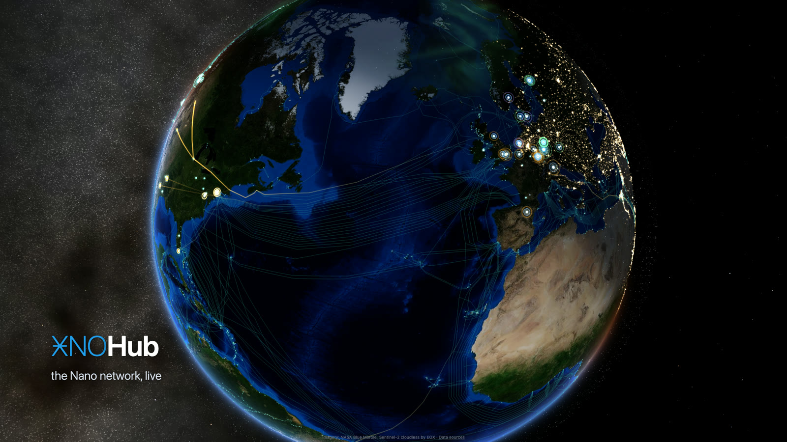
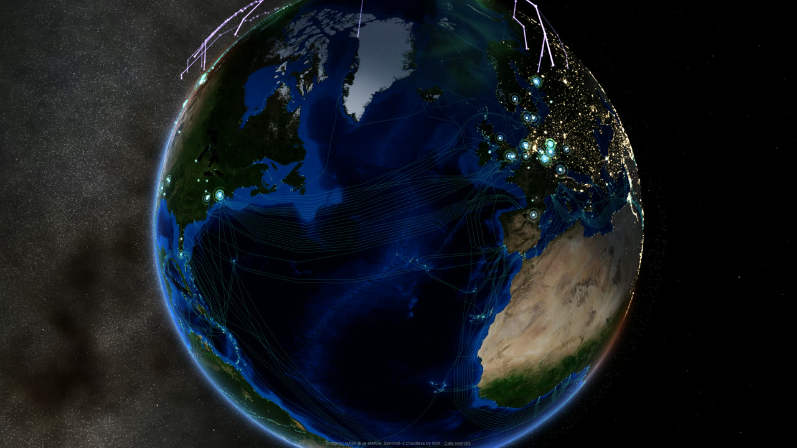
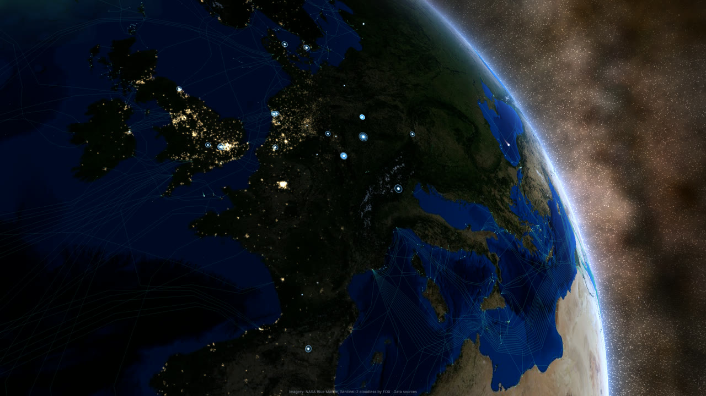
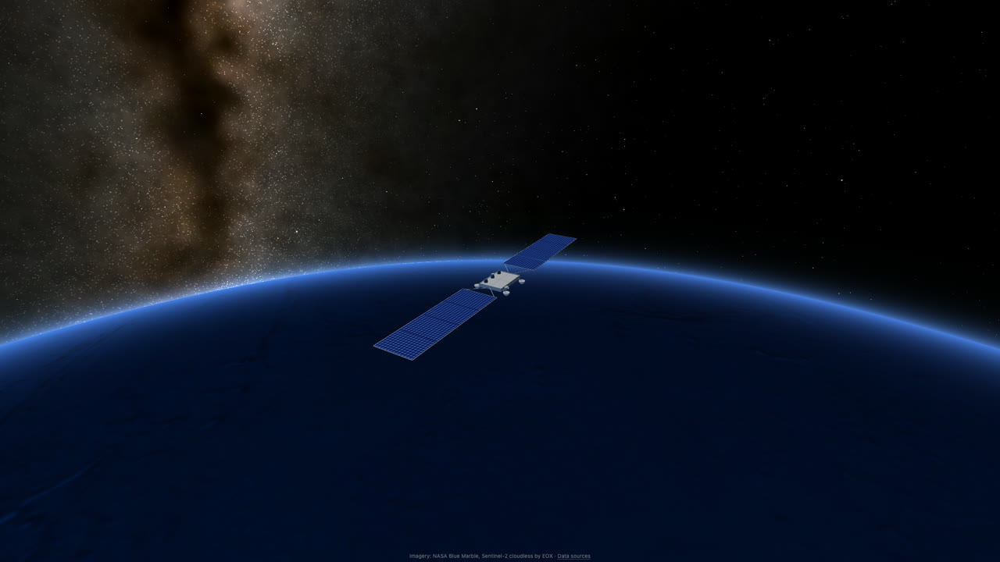
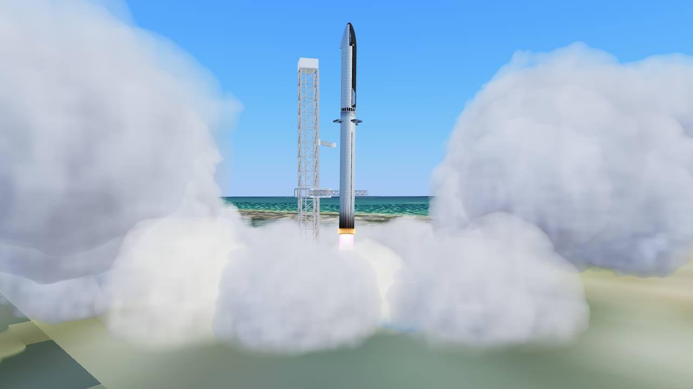
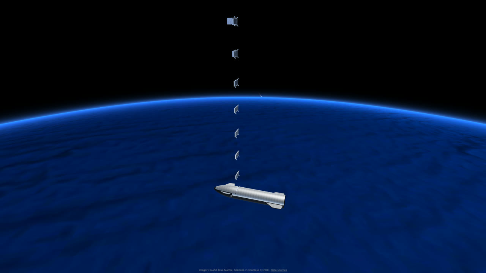

# 🌍 Nano Network Explorer - Interactive 3D Globe Visualization

<div align="center">

## Demo Video

[](docs/media/xnohub-trailer.mp4)

<sub>Click the image to watch the 30-second trailer, recorded from the live app.</sub>

<table>
<tr>
<td width="33%"><br/><sub>Every node votes: one block, every representative</sub></td>
<td width="33%"><br/><sub>Real nodes, real places, the real Sun</sub></td>
<td width="33%"><br/><sub>Ride a Starlink: real orbits, true scale</sub></td>
</tr>
<tr>
<td width="33%"><br/><sub>Launch Starship from Starbase, Pad 2</sub></td>
<td width="33%"><br/><sub>60 Starlink V3, one by one</sub></td>
<td width="33%"></td>
</tr>
</table>

</div>

---

## 📖 About This Project

This web application visualizes cryptocurrency networks on an interactive 3D globe. Watch real-time transactions fly across the world with SpaceX-inspired animations. Currently supporting both Nano and Banano networks.

### Features
- **Real-time Network Visualization**
  - Live transaction tracking across the globe
  - Real-time node location mapping
  - Network activity monitoring
  - Built-in mock data support for instant testing
- **Advanced 3D Globe Features**
  - Dynamic day/night cycle simulation
  - Realistic moving cloud layers
  - Interactive 3D globe interface
- **SpaceX-Inspired Animations**
  - Starship launches from Starbase
  - The real Starlink constellation in orbit
  - Multiple camera perspectives:
    - Free-roaming POV
    - Rocket chase camera
    - First-person view from rocket looking back at Earth
- **Multi-Network Support**
  - Nano network visualization
  - Banano network visualization
  - Easy adaptation for other networks
- **Highly Customizable**
  - Configurable transaction arcs (height, speed, duration, length)
  - Adjustable animation parameters
  - Flexible network integration

### Network Adaptation
This visualization can be easily adapted to other networks in two steps:
1. Update WebSocket connections and data interfaces
2. Configure node lists and related network logic

Mock data is included out of the box, allowing you to run and test the visualization without any external configuration.

---

## 💫 Supported Networks

### What is Nano?

[Nano](https://nano.org) is a sustainable digital currency and payment protocol designed to be accessible and lightweight, with a focus on removing inefficiencies present in other cryptocurrencies. Also known as "Nano Currency" or "Nano Crypto", Nano started development in 2014 (originally called RaiBlocks/XRB) and is one of the first Directed Acyclic Graph (DAG) based blockchains, utilizing a unique block-lattice architecture. In January 2018, RaiBlocks was rebranded to Nano to make it more user-friendly and better reflect its fast, efficient nature.

#### Key Features and Benefits:

- **Fee-less Transactions**: Nano operates with zero fees for all transactions, making it ideal for microtransactions.
- **Instant Payments**: Transactions are processed in under 1 second (0.35 seconds on average), providing a seamless user experience.
- **Energy Efficient**: Nano is eco-friendly, using minimal energy compared to traditional crypto networks.
- **Hardware-Bound Scalability**: Unlike traditional blockchains that face protocol-level bottlenecks, Nano's performance scales directly with:
  - Hardware I/O capabilities
  - Network bandwidth improvements
  - Database technology advancements
  - CPU/GPU processing power
- **Advanced Architecture**: The block-lattice design allows for asynchronous updates, where each account has its own blockchain, enabling parallel processing and eliminating traditional blockchain bottlenecks.
- **Future-Proof Design**: By being bound only by hardware limitations rather than protocol constraints, Nano naturally becomes faster as technology improves, making it a future-proof solution for digital payments.
- **Fair Distribution**: Nano was distributed freely through a captcha-based faucet system from 2015 to 2017, ensuring fair access to everyone. No ICO, no pre-mine, and no insider advantages.

### What is Banano?

[Banano](https://banano.cc) is a feeless, instant cryptocurrency forked from Nano in 2018. While maintaining all of Nano's technical benefits, Banano adds a fun, meme-driven approach to cryptocurrency. The project is known for being the #1 contributor to [Folding@Home](https://foldingathome.org/), helping medical research with over 2,500 years of computational work.

---

## 🚀 Getting Started

### Prerequisites

Before running the application, make sure you have pnpm installed:
```bash
npm install -g pnpm
```

### Setup

1. Clone the repository
2. (Optional) Copy `.env.local.example` to `.env.local` if you want to use live data:
```env
# Mock data is included by default - no configuration needed for testing!
# For live data, configure these:

NEXT_PUBLIC_USE_SAMPLE_DATA=false  # Set to true to use mock data

# Nano
NEXT_PUBLIC_WS_URL=wss://example-nano-node.com/ws
NEXT_PUBLIC_NANO_DONATION_ACCOUNT=nano_1youraddress...

# Banano
NEXT_PUBLIC_BANANO_WS_URL=wss://example-banano-node.com/ws
NEXT_PUBLIC_BANANO_DONATION_ACCOUNT=ban_1youraddress...
```

### Quick Start (with mock data)
```bash
pnpm install
pnpm dev  # Mock data works out of the box!
```
Visit `/` for Nano visualization or `/banano` for Banano visualization

### Development with Live Data
After configuring `.env.local`:
```bash
pnpm install
pnpm dev
```

### Production
```bash
pnpm build
pnpm start
```

---

## 📜 License & Credits

### License
This project is licensed under the MIT License. See the LICENSE file for more details.

### Data and imagery credits
The vehicles (Starlink, Starship, Super Heavy) are modelled in code; no third-party 3D models are used. The full list is on the page under "Data sources".
- Earth from high up: NASA Blue Marble, served by NASA GIBS (public domain)
- Earth close up: Sentinel-2 cloudless 2016 by EOX (CC BY 4.0, contains modified Copernicus Sentinel data 2016), on Terrain Tiles on AWS
- Clouds: NASA GIBS (VIIRS). Aurora and solar wind: NOAA Space Weather Prediction Center
- City lights: GeoNames (CC BY 4.0). Stars: Yale Bright Star Catalogue. Milky Way: NASA Scientific Visualization Studio, from ESA Gaia
- Starlink orbits: CelesTrak. Submarine cables: TeleGeography. Sun, Moon and planets: Astronomy Engine
- Nano nodes: nano.community
- Starbase: positions from OpenStreetMap (ODbL), tower heights from FAA obstruction filings; colours and some heights are estimates, listed under "Data sources"

---

## 📫 Contact

X (Twitter): [@dalinhuang](https://x.com/dalinhuang)

## Media

- `public/open-graph/xnohub.png`: the social card (1200×630), used for OpenGraph and X.
- `docs/media/`: the README's poster, stills and the 720p trailer.

All of it is rendered from the running app (`pnpm dev`, then from the repo root):
```bash
node scripts/video/record.mjs            # the trailer: video/out/xnohub-trailer.mp4, a 720p cut and the poster
node scripts/video/record.mjs --stills   # the poster and stills as PNGs in video/out/stills
```
